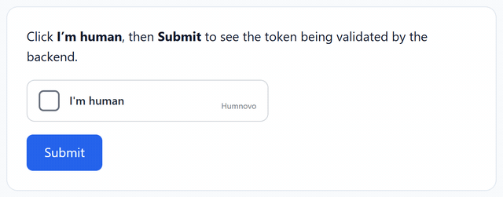
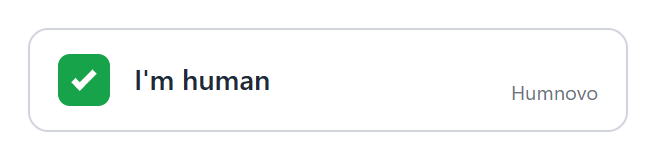
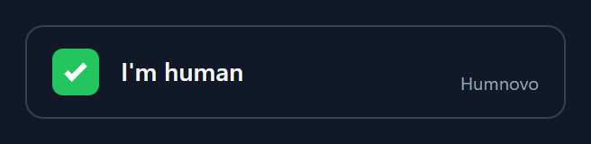

# Humnovo

[🇧🇷 Português](README.md) · **🇺🇸 English**

> Lightweight, privacy-first, open source human verification that protects websites and apps from spam and bots.

[](LICENSE)

[](CONTRIBUTING.md)
[](https://github.com/sponsors/psflow)

<p align="center">
  
</p>

> 💙 **Contributions welcome.** See [how to help](#-contributing) or look for issues labeled [`good first issue`](https://github.com/psflow/humnovo/labels/good%20first%20issue).

---

## 📖 About

**Humnovo** is an open source human verification project built to protect websites and applications from bots, spam and malicious automated activity.

It provides a **modern, lightweight, secure and accessible** human verification layer that is easy to plug into any platform through libraries, APIs and reusable components.

With a focus on **privacy, simplicity and flexibility**, Humnovo helps applications tell real users apart from automation while keeping the experience smooth for users and developers.

---

## ✨ Features

- 🛡️ **Bot protection**: blocks spam and malicious automation
- 🔒 **Privacy first**: no invasive user tracking
- ⚡ **Lightweight**: minimal impact on page load and performance
- ♿ **Accessible**: keyboard navigable and screen reader friendly
- 🧩 **Easy integration**: libraries, REST API and reusable components
- 🎯 **One click**: smooth, non-intrusive verification
- 🔧 **Flexible**: configurable security levels
- 🌐 **Open source**: transparent, auditable and community driven

---

## 🧠 How it works

```
┌──────────────┐     ┌──────────────────┐     ┌──────────────────┐
│     User     │────▶│  Humnovo widget  │────▶│  Verification    │
│   (browser)  │     │  (client-side)   │     │  API             │
└──────────────┘     └──────────────────┘     └────────┬─────────┘
                                                       │ token
                                                       ▼
                                              ┌──────────────────┐
                                              │  Your backend    │
                                              │  validates token │
                                              └──────────────────┘
```

1. The Humnovo widget loads on your page.
2. Verification runs in a lightweight, non-intrusive way.
3. A verification token is issued.
4. Your backend validates the token against the Humnovo API (single use).

---

## 🚀 Installation (3 steps)

Humnovo is **self-hosted**: you run a tiny server (zero dependencies, just Node.js 18+) and any website, in any language, can use it.

**1. Generate your keys**

```bash
npx humnovo keys
# HUMNOVO_SITE_KEY=hn_pk_...
# HUMNOVO_SECRET_KEY=hn_sk_...
```

**2. Start the server** (pick one)

```bash
# Node.js
HUMNOVO_SITE_KEY=hn_pk_... HUMNOVO_SECRET_KEY=hn_sk_... HUMNOVO_HOSTNAMES=mysite.com npx humnovo

# Docker
docker build -t humnovo https://github.com/psflow/humnovo.git
docker run -p 8787:8787 -e HUMNOVO_SITE_KEY=hn_pk_... -e HUMNOVO_SECRET_KEY=hn_sk_... humnovo
```

Or in one click on Render (keys are generated automatically; in production, set `HUMNOVO_DEMO=0` and `HUMNOVO_HOSTNAMES`):

[](https://render.com/deploy?repo=https://github.com/psflow/humnovo)

> Just want to try it? Run `npx humnovo` with no configuration and open http://localhost:8787 for a demo page with temporary keys.

**3. Add the widget to your form and validate the token on your backend** (see below).

---

## 💻 Usage

### Front-end (HTML): works on any website

```html
<form action="/submit" method="POST">
  <input type="email" name="email" placeholder="Your email" />

  <div class="humnovo" data-sitekey="YOUR_SITE_KEY"></div>

  <button type="submit">Submit</button>
</form>

<script src="https://humnovo.yoursite.com/widget.js" async defer></script>
```

<p>
  
  
</p>

The widget adds a hidden `humnovo-token` field to the form. The API URL is inferred from the script's `src` (or set `data-api`).

| Attribute                | Description                                      |
|--------------------------|--------------------------------------------------|
| `data-sitekey`           | Public site key (required)                       |
| `data-theme`             | `auto` (default), `light` or `dark`              |
| `data-lang`              | `auto` (default), `pt-BR`, `en`, `es`            |
| `data-api`               | Humnovo server URL                               |
| `data-callback`          | Name of a global function called with the token  |
| `data-error-callback`    | Global function called on error                  |
| `data-expired-callback`  | Global function called when the token expires    |
| `data-input-name`        | Hidden field name (default `humnovo-token`)      |

The DOM events `humnovo:success`, `humnovo:error` and `humnovo:expired` are dispatched as well.

### Front-end (JavaScript / bundlers)

```javascript
import { Humnovo } from 'humnovo';

const humnovo = new Humnovo({
  siteKey: 'YOUR_SITE_KEY',
  apiUrl: 'https://humnovo.yoursite.com',
  container: '#humnovo-container',
  onSuccess: (token) => console.log('Verified:', token),
  onError: (error) => console.error('Verification failed:', error.code),
});

humnovo.render();
// humnovo.getToken(), humnovo.reset(), humnovo.destroy()
```

### Back-end: token validation (any language)

```javascript
const response = await fetch('https://humnovo.yoursite.com/v1/verify', {
  method: 'POST',
  headers: { 'Content-Type': 'application/json' },
  body: JSON.stringify({
    secret: process.env.HUMNOVO_SECRET_KEY,
    token: req.body['humnovo-token'],
  }),
});

const result = await response.json();

if (result.success) {
  // Verified human
} else {
  // Block the request
}
```

Ready-made examples in [`examples/`](examples/): plain HTML, Express and PHP.

### Node.js back-end: embedded in your app (no separate server)

```javascript
import express from 'express';
import { createHumnovo } from 'humnovo/server';

const humnovo = createHumnovo({
  sites: [{ siteKey: process.env.HUMNOVO_SITE_KEY, secret: process.env.HUMNOVO_SECRET_KEY, hostnames: ['mysite.com'] }],
});

app.use('/humnovo', humnovo); // serves /humnovo/widget.js and the API

app.post('/contact', express.urlencoded({ extended: false }), async (req, res) => {
  const result = await humnovo.verify(req.body['humnovo-token']);
  if (!result.success) return res.status(400).send('Verification failed');
  // ...
});
```

It also works with plain `node:http`: `http.createServer(createHumnovo({...}))`.

---

## 🔬 Under the hood

1. **Proof-of-work (PoW) challenge**: the server sends a `salt` and a `SHA-256(salt + n)` hash; the browser must find `n`. The challenge is HMAC-signed, so the server stays stateless.
2. **Background solving**: starts as soon as the user hovers or focuses the widget, runs in a Web Worker and takes a fraction of a second. For anyone automating at scale, the CPU cost adds up.
3. **Lightweight interaction signals**: trusted click (`isTrusted`), time since load, pointer movement, keyboard or touch, and `navigator.webdriver`. These are **only counters and booleans**: no cookies, no fingerprinting, no personal data.
4. **Single-use token**: signed, short-lived (5 min) and bound to the hostname. Your backend validates it exactly once.

> ⚠️ No solution blocks 100% of bots. Humnovo raises the cost of automation; for critical targets, combine it with rate limiting. See the [threat model](SECURITY.md).

**Size:** ~19 KB widget (~7 KB gzipped), zero dependencies, styles isolated with Shadow DOM.
**Accessibility:** keyboard navigable, `role="checkbox"` with ARIA states, `aria-live` status messages and `prefers-reduced-motion` support.

---

## 📡 API

### `GET /v1/challenge?sitekey=...`

Returns a signed challenge (used by the widget).

### `POST /v1/solve`

Receives the solution and signals and returns `{ success, token, expiresIn }` (used by the widget).

### `POST /v1/verify`

| Parameter | Type     | Required | Description                 |
|-----------|----------|----------|-----------------------------|
| `secret`  | `string` | Yes      | Your secret key             |
| `token`   | `string` | Yes      | Token issued to the widget  |

Accepts JSON or `application/x-www-form-urlencoded`.

**Response:**

```json
{
  "success": true,
  "timestamp": "2026-11-08T14:50:00.000Z",
  "hostname": "yoursite.com",
  "siteKey": "hn_pk_..."
}
```

On failure: `{ "success": false, "error": "token-expired" }`. Possible codes: `invalid-input`, `invalid-token`, `invalid-secret`, `token-expired`, `token-reused`.

### Other routes

- `GET /widget.js`: the `<script>` widget
- `GET /health`: health check

---

## ⚙️ Configuration

### Widget

| Option       | Type       | Default           | Description                            |
|--------------|------------|-------------------|----------------------------------------|
| `siteKey`    | `string`   | —                 | Public site key                        |
| `container`  | `string`   | —                 | Selector or element to render into     |
| `apiUrl`     | `string`   | script origin     | Humnovo server URL                     |
| `theme`      | `string`   | `'auto'`          | `'light'`, `'dark'` or `'auto'`        |
| `language`   | `string`   | `'auto'`          | `'auto'`, `'pt-BR'`, `'en'`, `'es'`    |
| `inputName`  | `string`   | `'humnovo-token'` | Hidden form field name                 |
| `onSuccess`  | `function` | —                 | Called when verification succeeds      |
| `onError`    | `function` | —                 | Called on error                        |
| `onExpire`   | `function` | —                 | Called when the token expires          |

### Server

Via environment variables (`PORT`, `HOST`, `HUMNOVO_SITE_KEY`, `HUMNOVO_SECRET_KEY`, `HUMNOVO_HOSTNAMES`, `HUMNOVO_LEVEL`) or a `humnovo.config.json` with multiple sites (see [`humnovo.config.example.json`](humnovo.config.example.json)):

| Site option   | Default    | Description                                                         |
|---------------|------------|---------------------------------------------------------------------|
| `siteKey`     | —          | Public key                                                          |
| `secret`      | —          | Secret key (min. 16 characters)                                     |
| `hostnames`   | any        | Allowed domains; supports wildcards like `*.mysite.com`             |
| `level`       | `medium`   | `low` (light PoW only), `medium` or `high` (bigger PoW, stricter signals) |
| `maxNumber`   | per level  | PoW difficulty (average hashes = `maxNumber / 2`)                   |

To run multiple instances behind a load balancer, pass a shared `store` (e.g. Redis) to `createHumnovo({ store })`: any object with `consume(key, expiresAt) → boolean`.

---

## 🗺️ Roadmap

- [x] Base JavaScript widget
- [x] Verification REST API
- [x] Self-hosting (Node.js, Docker and Render)
- [ ] React, Vue and Angular components
- [ ] Python, PHP and Java SDKs
- [ ] Official Redis store and built-in rate limiting
- [ ] Invisible mode
- [ ] Admin dashboard
- [ ] WordPress and other platform plugins
- [ ] More languages

---

## 🧪 Development

```bash
npm test        # tests (node:test, zero dependencies)
npm start       # local server in demo mode
npm run build   # builds dist/humnovo.js
```

---

## 🤝 Contributing

Contributions are very welcome!

1. Fork the project
2. Create a branch: `git checkout -b feature/my-feature`
3. Commit your changes: `git commit -m 'feat: add my feature'`
4. Push the branch: `git push origin feature/my-feature`
5. Open a Pull Request

Before contributing, please read [CONTRIBUTING.md](CONTRIBUTING.md) and the [Code of Conduct](CODE_OF_CONDUCT.md). Issues and PRs in English or Portuguese are welcome.

---

## 💙 Support the project

Humnovo is free and open source. If it helps your website or app, please consider supporting it through **[GitHub Sponsors](https://github.com/sponsors/psflow)**.

Sponsorship funds development time for new features (React/Vue components, WordPress plugin, invisible mode), maintenance, documentation and security reviews.

Can't support financially? Starring ⭐ the repo, sharing the project or opening an issue with feedback helps a lot too.

---

## 🔐 Security

Found a vulnerability? **Please don't open a public issue.** See [SECURITY.md](SECURITY.md) for responsible disclosure.

---

## 📄 License

Distributed under the MIT License. See [LICENSE](LICENSE) for details.

---

## 👤 Author

**Pedro Silva**

- GitHub: [@psflow](https://github.com/psflow)
- LinkedIn: [workerpedro](https://linkedin.com/in/workerpedro)

---

<p align="center">Made with 💙 for a more human web.</p>
