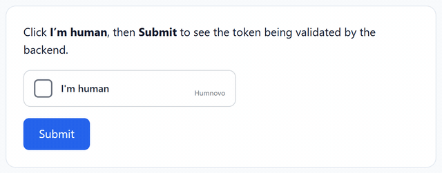
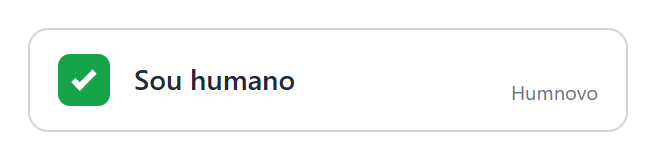
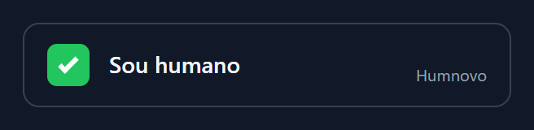

# Humnovo

**🇧🇷 Português** · [🇺🇸 English](README.md)

> Verificação humana open source, leve e focada em privacidade, que protege sites e aplicativos contra spam e bots.

[](LICENSE)

[](CONTRIBUTING.md)
[](https://github.com/sponsors/psflow)

<p align="center">
  
</p>

> 💙 **Projeto aberto a contribuições.** Veja [como ajudar](#-contribuindo) ou procure issues marcadas com [`good first issue`](https://github.com/psflow/humnovo/labels/good%20first%20issue).

---

## 📖 Sobre

O **Humnovo** é um projeto open source de verificação humana criado para proteger sites e aplicações contra bots, spam e atividades automatizadas maliciosas.

A proposta é oferecer uma camada **moderna, leve, segura e acessível** de autenticação humana, fácil de integrar a qualquer plataforma por meio de bibliotecas, APIs e componentes reutilizáveis.

Com foco em **privacidade, simplicidade e flexibilidade**, o Humnovo ajuda aplicações a distinguir usuários reais de automações, priorizando uma experiência fluida para usuários e desenvolvedores.

---

## ✨ Principais características

- 🛡️ **Proteção contra bots**: bloqueia spam e automações maliciosas
- 🔒 **Privacidade em primeiro lugar**: sem rastreamento invasivo de usuários
- ⚡ **Leve**: impacto mínimo no carregamento e na performance
- ♿ **Acessível**: navegável por teclado e compatível com leitores de tela
- 🧩 **Fácil integração**: bibliotecas, API REST e componentes reutilizáveis
- 🎯 **Um clique**: verificação fluida e não intrusiva
- 🔧 **Flexível**: configurável para diferentes níveis de segurança
- 🌐 **Open source**: transparente, auditável e mantido pela comunidade

---

## 🧠 Como funciona

```
┌──────────────┐     ┌──────────────────┐     ┌──────────────────┐
│   Usuário    │────▶│  Widget Humnovo  │────▶│  API de          │
│  (navegador) │     │  (client-side)   │     │  Verificação     │
└──────────────┘     └──────────────────┘     └────────┬─────────┘
                                                       │ token
                                                       ▼
                                              ┌──────────────────┐
                                              │  Seu backend     │
                                              │  valida o token  │
                                              └──────────────────┘
```

1. O widget do Humnovo é carregado na página.
2. A verificação ocorre de forma leve e não intrusiva.
3. Um token de verificação é gerado.
4. O backend da sua aplicação valida o token junto à API do Humnovo (uso único).

---

## 🚀 Instalação (3 passos)

O Humnovo é **self-hosted**: você roda um servidor minúsculo (zero dependências, só Node.js 18+) e qualquer site, em qualquer linguagem, passa a usá-lo.

**1. Gere as chaves**

```bash
npx humnovo keys
# HUMNOVO_SITE_KEY=hn_pk_...
# HUMNOVO_SECRET_KEY=hn_sk_...
```

**2. Suba o servidor** (escolha um)

```bash
# Node.js
HUMNOVO_SITE_KEY=hn_pk_... HUMNOVO_SECRET_KEY=hn_sk_... HUMNOVO_HOSTNAMES=meusite.com.br npx humnovo

# Docker
docker build -t humnovo https://github.com/psflow/humnovo.git
docker run -p 8787:8787 -e HUMNOVO_SITE_KEY=hn_pk_... -e HUMNOVO_SECRET_KEY=hn_sk_... humnovo
```

Ou em um clique no Render (as chaves são geradas automaticamente; em produção, defina `HUMNOVO_DEMO=0` e `HUMNOVO_HOSTNAMES`):

[](https://render.com/deploy?repo=https://github.com/psflow/humnovo)

> Quer só experimentar? Rode `npx humnovo` sem nada e abra http://localhost:8787: há uma página demo com chaves temporárias.

**3. Coloque o widget no formulário e valide o token no backend** (veja abaixo).

---

## 💻 Uso básico

### Front-end (HTML): funciona em qualquer site

```html
<form action="/enviar" method="POST">
  <input type="email" name="email" placeholder="Seu e-mail" />

  <div class="humnovo" data-sitekey="SUA_CHAVE_PUBLICA"></div>

  <button type="submit">Enviar</button>
</form>

<script src="https://humnovo.seusite.com/widget.js" async defer></script>
```

<p>
  
  
</p>

O widget adiciona ao formulário um campo oculto `humnovo-token`. A URL da API é descoberta a partir do `src` do script (ou use `data-api`).

| Atributo                 | Descrição                                         |
|--------------------------|---------------------------------------------------|
| `data-sitekey`           | Chave pública (obrigatório)                       |
| `data-theme`             | `auto` (padrão), `light` ou `dark`                |
| `data-lang`              | `auto` (padrão), `pt-BR`, `en`, `es`              |
| `data-api`               | URL do servidor Humnovo                           |
| `data-callback`          | Nome de função global chamada com o token         |
| `data-error-callback`    | Função global chamada em caso de erro             |
| `data-expired-callback`  | Função global chamada quando o token expira       |
| `data-input-name`        | Nome do campo oculto (padrão `humnovo-token`)     |

Também são disparados os eventos DOM `humnovo:success`, `humnovo:error` e `humnovo:expired`.

### Front-end (JavaScript / bundlers)

```javascript
import { Humnovo } from 'humnovo';

const humnovo = new Humnovo({
  siteKey: 'SUA_CHAVE_PUBLICA',
  apiUrl: 'https://humnovo.seusite.com',
  container: '#humnovo-container',
  onSuccess: (token) => console.log('Verificação concluída:', token),
  onError: (error) => console.error('Falha na verificação:', error.code),
});

humnovo.render();
// humnovo.getToken(), humnovo.reset(), humnovo.destroy()
```

### Back-end: validação do token (qualquer linguagem)

```javascript
const response = await fetch('https://humnovo.seusite.com/v1/verify', {
  method: 'POST',
  headers: { 'Content-Type': 'application/json' },
  body: JSON.stringify({
    secret: process.env.HUMNOVO_SECRET_KEY,
    token: req.body['humnovo-token'],
  }),
});

const result = await response.json();

if (result.success) {
  // Usuário humano verificado
} else {
  // Bloquear requisição
}
```

Exemplos prontos em [`examples/`](examples/): HTML puro, Express e PHP.

### Back-end Node.js: embutido na sua aplicação (sem servidor separado)

```javascript
import express from 'express';
import { createHumnovo } from 'humnovo/server';

const humnovo = createHumnovo({
  sites: [{ siteKey: process.env.HUMNOVO_SITE_KEY, secret: process.env.HUMNOVO_SECRET_KEY, hostnames: ['meusite.com.br'] }],
});

app.use('/humnovo', humnovo); // serve /humnovo/widget.js e a API

app.post('/contato', express.urlencoded({ extended: false }), async (req, res) => {
  const result = await humnovo.verify(req.body['humnovo-token']);
  if (!result.success) return res.status(400).send('Verificação falhou');
  // ...
});
```

Funciona também com `node:http` puro: `http.createServer(createHumnovo({...}))`.

---

## 🔬 Como a verificação funciona por dentro

1. **Desafio de prova de trabalho (PoW)**: o servidor envia um `salt` e um hash `SHA-256(salt + n)`; o navegador precisa descobrir `n`. O desafio é assinado com HMAC, então o servidor não guarda estado.
2. **Resolução em segundo plano**: começa assim que o usuário passa o mouse/foca no widget, roda num Web Worker e leva frações de segundo. Para quem automatiza em escala, o custo de CPU se acumula.
3. **Sinais de interação leves**: clique confiável (`isTrusted`), tempo desde o carregamento, movimento de ponteiro, teclado ou toque e `navigator.webdriver`. São **apenas contadores e booleanos**: sem cookies, fingerprint ou dados pessoais.
4. **Token de uso único**: assinado, com expiração curta (5 min) e preso ao hostname. Seu backend valida uma única vez.

> ⚠️ Nenhuma solução bloqueia 100% dos bots. O Humnovo aumenta o custo da automação; para alvos críticos, combine com rate limiting. Veja o [modelo de ameaça](SECURITY.md).

**Peso:** widget de ~19 KB (~7 KB gzip), sem dependências, com estilos isolados em Shadow DOM.
**Acessibilidade:** navegável por teclado, `role="checkbox"` com estados ARIA, mensagens em `aria-live` e respeito a `prefers-reduced-motion`.

---

## 📡 API

### `GET /v1/challenge?sitekey=...`

Retorna um desafio assinado (usado pelo widget).

### `POST /v1/solve`

Recebe a solução e os sinais e devolve `{ success, token, expiresIn }` (usado pelo widget).

### `POST /v1/verify`

| Parâmetro | Tipo     | Obrigatório | Descrição                         |
|-----------|----------|-------------|-----------------------------------|
| `secret`  | `string` | Sim         | Chave secreta da aplicação        |
| `token`   | `string` | Sim         | Token gerado pelo widget          |

Aceita JSON ou `application/x-www-form-urlencoded`.

**Resposta:**

```json
{
  "success": true,
  "timestamp": "2026-11-08T14:50:00.000Z",
  "hostname": "seusite.com",
  "siteKey": "hn_pk_..."
}
```

Em caso de falha: `{ "success": false, "error": "token-expired" }`. Códigos possíveis: `invalid-input`, `invalid-token`, `invalid-secret`, `token-expired`, `token-reused`.

### Outras rotas

- `GET /widget.js`: o widget para `<script>`
- `GET /health`: verificação de saúde

---

## ⚙️ Configuração

### Widget

| Opção        | Tipo       | Padrão            | Descrição                              |
|--------------|------------|-------------------|----------------------------------------|
| `siteKey`    | `string`   | —                 | Chave pública do site                  |
| `container`  | `string`   | —                 | Seletor ou elemento onde será exibido  |
| `apiUrl`     | `string`   | origem do script  | URL do servidor Humnovo                |
| `theme`      | `string`   | `'auto'`          | `'light'`, `'dark'` ou `'auto'`        |
| `language`   | `string`   | `'auto'`          | `'auto'`, `'pt-BR'`, `'en'`, `'es'`    |
| `inputName`  | `string`   | `'humnovo-token'` | Nome do campo oculto do formulário     |
| `onSuccess`  | `function` | —                 | Callback ao concluir a verificação     |
| `onError`    | `function` | —                 | Callback em caso de erro               |
| `onExpire`   | `function` | —                 | Callback quando o token expira         |

### Servidor

Via variáveis de ambiente (`PORT`, `HOST`, `HUMNOVO_SITE_KEY`, `HUMNOVO_SECRET_KEY`, `HUMNOVO_HOSTNAMES`, `HUMNOVO_LEVEL`) ou um `humnovo.config.json` com vários sites (veja [`humnovo.config.example.json`](humnovo.config.example.json)):

| Opção do site | Padrão     | Descrição                                                        |
|---------------|------------|------------------------------------------------------------------|
| `siteKey`     | —          | Chave pública                                                    |
| `secret`      | —          | Chave secreta (mín. 16 caracteres)                               |
| `hostnames`   | qualquer   | Domínios permitidos; aceita curinga `*.meusite.com`              |
| `level`       | `medium`   | `low` (só PoW leve), `medium` ou `high` (PoW maior e sinais mais rigorosos) |
| `maxNumber`   | pelo nível | Dificuldade do PoW (média de hashes = `maxNumber / 2`)           |

Para várias instâncias atrás de um load balancer, passe um `store` compartilhado (ex.: Redis) para `createHumnovo({ store })`: qualquer objeto com `consume(key, expiresAt) → boolean`.

---

## 🗺️ Roadmap

- [x] Widget JavaScript base
- [x] API REST de verificação
- [x] Opção de self-hosting (Node.js, Docker e Render)
- [ ] Componentes para React, Vue e Angular
- [ ] SDKs para Python, PHP e Java
- [ ] Store Redis oficial e rate limiting embutido
- [ ] Modo invisível
- [ ] Painel de administração
- [ ] Plugins para WordPress e outras plataformas
- [ ] Mais idiomas

---

## 🧪 Desenvolvimento

```bash
npm test        # testes (node:test, sem dependências)
npm start       # servidor local em modo demo
npm run build   # gera dist/humnovo.js
```

---

## 🤝 Contribuindo

Contribuições são muito bem-vindas!

1. Faça um fork do projeto
2. Crie uma branch para sua feature: `git checkout -b feature/minha-feature`
3. Faça commit das alterações: `git commit -m 'feat: adiciona minha feature'`
4. Envie para o repositório: `git push origin feature/minha-feature`
5. Abra um Pull Request

Antes de contribuir, leia o [CONTRIBUTING.md](CONTRIBUTING.md) e o [Código de Conduta](CODE_OF_CONDUCT.md).

---

## 💙 Apoie o projeto

O Humnovo é gratuito e open source. Se ele ajuda o seu site ou aplicativo, considere apoiar pelo **[GitHub Sponsors](https://github.com/sponsors/psflow)**.

O apoio financia tempo de desenvolvimento para novas funcionalidades (componentes React/Vue, plugin WordPress, modo invisível), manutenção, documentação e revisões de segurança.

Não pode apoiar financeiramente? Dar uma ⭐ no repositório, compartilhar o projeto ou abrir uma issue com feedback também ajuda muito.

---

## 🔐 Segurança

Encontrou uma vulnerabilidade? **Não abra uma issue pública.** Consulte o [SECURITY.md](SECURITY.md) para reportá-la de forma responsável.

---

## 📄 Licença

Distribuído sob a licença MIT. Veja o arquivo [LICENSE](LICENSE) para mais detalhes.

---

## 👤 Autor

**Pedro Silva**

- GitHub: [@psflow](https://github.com/psflow)
- LinkedIn: [workerpedro](https://linkedin.com/in/workerpedro)

---

<p align="center">Feito com 💙 para uma web mais humana.</p>
